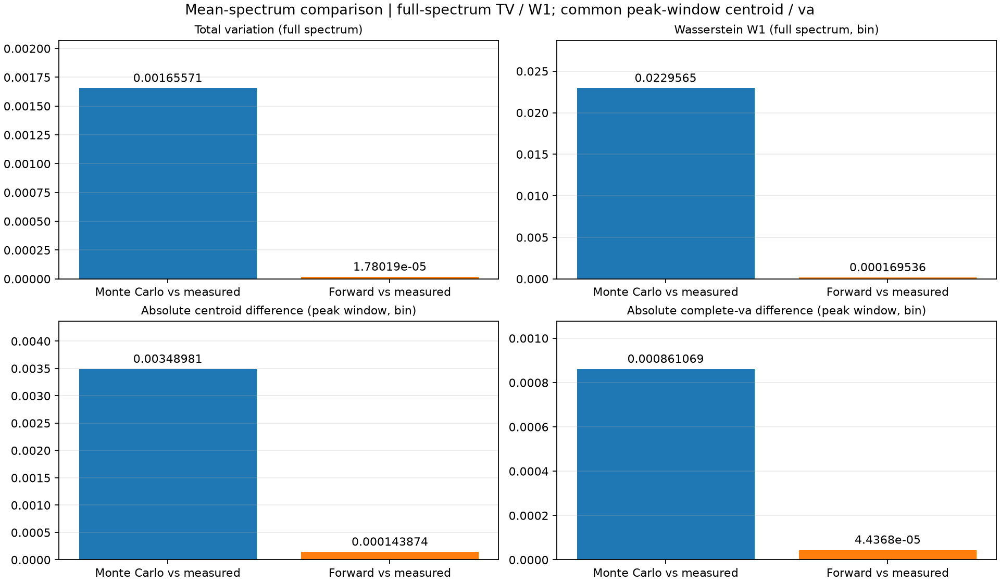

# 无背景光88%前100条反演与仿真对比结果

数据文件：`31_spad1_event40000_lux0_88%_hist_dspfulldata.csv`。

实际使用前100条记录，每条40000周期，死时间120 bin，随机种子20261110。

平均反演光子数：每周期全窗 **0.937802682240** 个；
折算每40000周期全窗 **37512.107290** 个。

先逐条反演，再按bin平均lambda，作为仿真输入；全部2048个bin都参与，不对齐峰位、不归一化。

最低可用概率：0.389425000，所有反演bin均有效。
逐条反演再前向的最大计数差：9.095e-13。这一项验证代数和实现一致性。

| 指标 | 实测均值 | 实测帧间标准差 | 仿真均值 | 仿真帧间标准差 |
| --- | ---: | ---: | ---: | ---: |
| total_counts | 24496.940000000 | 100.568567493 | 24502.720000000 | 103.831456280 |
| csum | 23832.670000000 | 116.150241220 | 23852.807100000 | 128.647197736 |
| ctd | 57.116357227 | 0.086188514 | 57.128411080 | 0.050812956 |
| va | 3.485284508 | 0.027912696 | 3.490345722 | 0.027186240 |
| snr | 154.332553599 | 0.376413729 | 154.397781813 | 0.417286024 |

有效峰：实测100/100，仿真100/100，判据csum>20且SNR≥8。

## 平均直方图的四项对比指标

先对各自平均谱按全谱总数归一化为p、q。TV = 0.5 × sum(abs(p - q))，范围0到1；一阶Wasserstein距离W1 = sum(abs(cumsum(p - q)[:-1]))，bin间距为1，单位bin，将各bin质量置于bin中心。两项均使用全部bin，不裁剪尾部或对齐峰位。质心和完整va在同一个主峰窗口内计算，不额外扣背景；复用基线compute_ctd_va，bin i覆盖[i-0.5, i+0.5)，va包含质心所在bin的部分积分，绝非方差。两项差值均取绝对值，单位bin。四项均越小表示越接近；它们描述谱形差异，不衡量绝对光子总数差异。主峰窗口内无有效光子或全谱总量为0时直接报错。

共同主峰窗口为`[41, 71)`，由实测平均谱峰值确定；实测、随机仿真、确定性前向均使用同一窗口。

| 比较对象 | TV（全谱） | Wasserstein 距离（全谱，bin） | 质心绝对差（主峰，bin） | va 绝对差（主峰，bin） |
| --- | ---: | ---: | ---: | ---: |
| 随机仿真均值 vs 实测均值 | 0.001655714 | 0.022956474 | 0.003489810 | 0.000861069 |
| 确定性前向期望 vs 实测均值 | 0.000017802 | 0.000169536 | 0.000143874 | 0.000044368 |

以上质心和va先对直方图求均值再计算，用于谱形比较；上表逐帧基线特征则先逐帧扣背景、计算特征再求均值，两者统计顺序与背景口径不同。
两批序列独立，帧号没有配对真值含义。四项指标不对同号实测帧与仿真帧逐一相减。

[四项指标CSV](comparison_metrics.csv)

[直方图对比](histogram_comparison.png) · [逐帧指标对比](feature_comparison.png)

光子数是模型反演估计。本次累计周期数为40000，死时间为120 bin；默认40000周期来自文件名，默认120 bin采用已确认的理论文档设置，未独立标定硬件模型。无背景光文件中的暗计数或杂散计数未额外去除。

本次用同一批实测数据反演并生成仿真，是同数据回代和随机重复性比较，不是独立物理验证。实测与仿真两列是独立序列，不按帧一一配对。平均输入仿真主要描述固定平均光通量下的计数波动，不包含实测帧间额外的强度漂移或时延漂移。

运行方法、模型及平均顺序见[仿真说明](../../README.md)。
3%与88%当前案例的平均响应一致性及适用范围内的可靠性结论见[仿真说明第9节](../../README.md#9-仿真与实测一致性及可靠性结论)。
