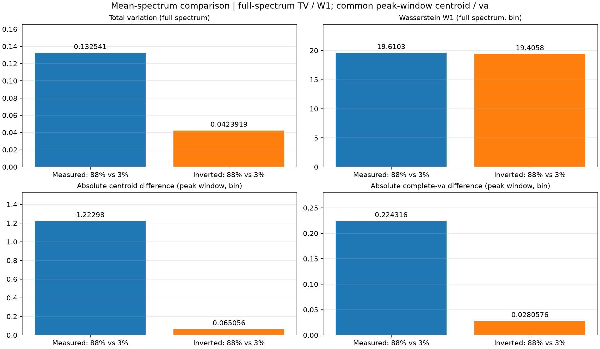
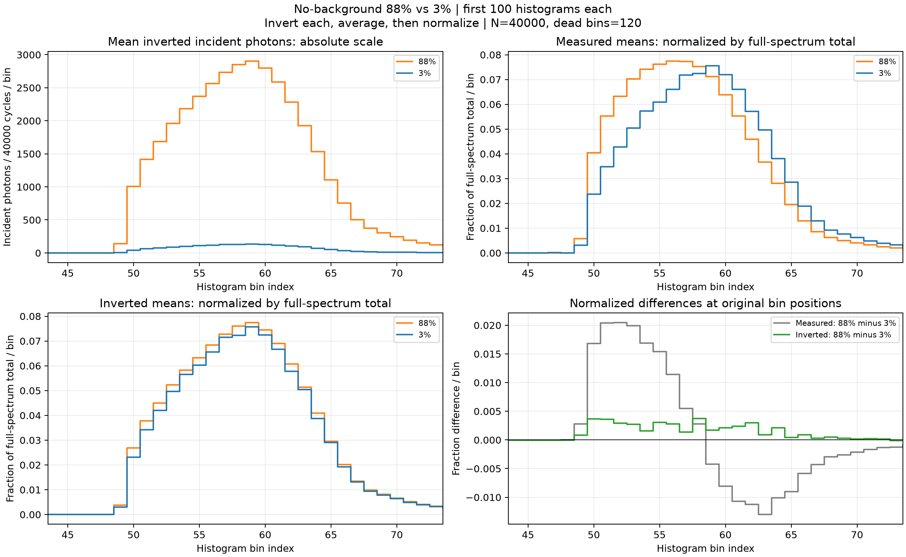

# 88%与3%前100条直方图的平均反演光子谱对比

各取数据行0至99（不含表头），每条40000周期，死时间120 bin，最低可用概率阈值0.02。

先逐条反演，再按bin求算术均值：`mean_lambda[i] = mean_k(inverse(H[k])[i])`。
每bin平均光子数为`num_cycles * mean_lambda[i]`。全谱归一化为`q[i] = mean_lambda[i] / sum_i(mean_lambda[i])`，每组全谱之和为1。
归一化在反演和平均之后进行；不采用峰值归一化或逐帧归一化。全部bin参与，保留原始位置，不对齐峰位、不平滑、不额外扣背景。

| 数据集 | 平均入射光子数/周期 | 平均入射光子数/条 | 入射光子数帧间标准差/条 | 平均实测计数/条 |
| --- | ---: | ---: | ---: | ---: |
| 88% | 0.937802682240 | 37512.107290 | 245.887413 | 24496.940000 |
| 3% | 0.044747519753 | 1789.900790 | 40.665992 | 1753.640000 |

88%与3%的平均反演总光子数之比：**20.957646**。该值由反演结果计算，不强制设置为88/3。

共同主峰窗口为`[44, 74)`，以3%平均反演谱峰值为中心；实测与反演的质心、va比较均使用该窗口。

先对各自平均谱按全谱总数归一化为p、q。TV = 0.5 × sum(abs(p - q))，范围0到1；一阶Wasserstein距离W1 = sum(abs(cumsum(p - q)[:-1]))，bin间距为1，单位bin，将各bin质量置于bin中心。两项均使用全部bin，不裁剪尾部或对齐峰位。质心和完整va在同一个主峰窗口内计算，不额外扣背景；复用基线compute_ctd_va，bin i覆盖[i-0.5, i+0.5)，va包含质心所在bin的部分积分，绝非方差。两项差值均取绝对值，单位bin。四项均越小表示越接近；它们描述谱形差异，不衡量绝对光子总数差异。主峰窗口内无有效光子或全谱总量为0时直接报错。

| 比较对象 | TV（全谱） | Wasserstein 距离（全谱，bin） | 质心绝对差（主峰，bin） | va 绝对差（主峰，bin） |
| --- | ---: | ---: | ---: | ---: |
| 归一化实测平均谱（88% vs 3%） | 0.132541272 | 19.610341169 | 1.222981368 | 0.224316166 |
| 归一化反演平均光子谱（88% vs 3%） | 0.042391887 | 19.405750070 | 0.065056032 | 0.028057592 |

**主峰波形结论：在当前无背景光数据及40000周期、120-bin死时间的设置下，88%与3%各前100条直方图逐条反演、按bin求均值并按各自全谱总光子数归一化后，两组平均光子谱的主峰波形基本一致，仍存在小幅残差。** 共同主峰窗口`[44,74)`内的质心绝对差约为0.06506 bin，完整va绝对差约为0.02806 bin；结合归一化叠图，支持两组主峰位置接近、形状较好吻合的判断。该结论针对前100条反演结果的平均主峰，不表示每条记录或整个光子谱完全一致，也不作为统计等效性的证明。

全谱Wasserstein距离也反映远端低计数尾部的影响，不应将其解释为主峰平移量；主峰位置差应看共同窗口内的质心差。

图中展示共同主峰窗口；CSV和全谱指标保留全部bin。实测归一化曲线作为反演前参照。
光子数为既有SPAD模型下的反演估计；归一化用于比较形状，不代表两组绝对光子数相等。

- [逐bin均值、光子数及归一化曲线](per_bin_comparison.csv)
- [逐条反演总光子数](per_histogram_photons.csv)
- [四项对比指标](comparison_metrics.csv)
- [参数与完整指标](summary.json)
