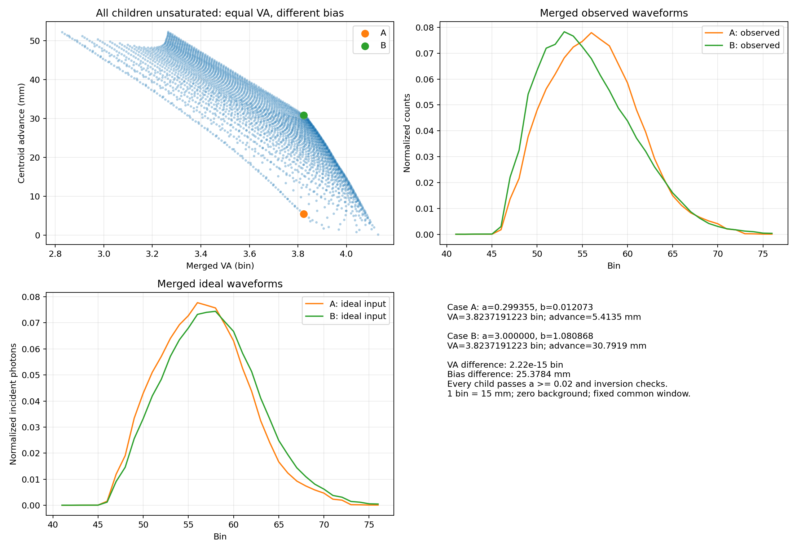

# 全部子直方图未饱和时，同 VA 是否可以对应不同质心偏移

本仿真找到一个明确反例：所有子谱均符合项目的未饱和判据且能可靠反演，合并观测的完整 VA 相同，但相对于各自真实合并输入波形的质心前移不同。

## 设置和处理方式

- 4 个独立 SPAD 分别探测后叠加计数，不是先叠加入射光再通过单个 SPAD。
- 使用已有数据集的实测 3% 反演归一化模板。4 个子谱形状固定，相对位移固定为 -3、-1、1、3 bin；只改变强度，分别取 `[a,a,b,b]`。
- 每个 SPAD 累计 5000 周期，死时间 120 bin，无背景。强度表示整条脉冲每周期的平均入射光子数；每 bin 输入为该强度乘以归一化模板。
- 搜索范围 `a,b∈[0.01,3]`，共 3200 个初始网格组合，再通过二分法精确匹配 VA。这是在有限扫描范围内找到的反例，不是全参数空间的最大偏移差。
- 对各子谱分别执行死时间前向模型，再合并观测。将理想输入强度相加，得到各案例自身的真实合并波形及参考质心。前移定义为 `理想合并质心−观测合并质心`，1 bin=15 mm。
- 质心和完整 VA 复用基线算法，包含分数 bin 积分。使用覆盖所有子谱的固定 36-bin 窗口 `[41,77)`（0 起始），避免寻峰移动或截窗造成的假差异。这里不采用运行基线的移动 30-bin 窗口，不施加 SNR 筛选。

脉冲支撑短于死时间，因此在一个子谱的脉冲内每周期最多探测一次。计算采用精确解 `p_i=exp(-sum(lambda_j,j<i))*(1-exp(-lambda_i))`。选中的两个案例又分别用项目 `forward_expected_counts` 核对输出，并逐个用 `invert_spad_histogram` 检查可反演性。

## 实际结果

| 项目 | 案例 A | 案例 B |
| --- | ---: | ---: |
| a（光子/周期） | 0.299354839 | 3.000000000 |
| b（光子/周期） | 0.012073429 | 1.080867565 |
| 合并观测 VA（bin） | 3.8237191223 | 3.8237191223 |
| 理想合并质心（bin） | 56.658592665 | 57.562969746 |
| 观测合并质心（bin） | 56.297692928 | 55.510177110 |
| 质心前移（mm） | 5.413496 | 30.791890 |
| 合并计数 csum | 2707.045159 | 16109.118993 |
| 所有子谱、所有 bin 最小可用概率 | 0.741296 | 0.049787 |

VA 差约 `2.22e-15 bin`，前移量差约 **25.378393 mm**。每个子谱所有 bin 均通过项目反演检查，可用概率均大于 0.02。合并计数可以超过 5000，因为它包含 4 个 SPAD 的累计结果。



未饱和在这里表示仍可可靠反演，并不表示没有死时间失真。改变各子谱的强度，还会改变合并输入的理想形状及理想 VA；理想合并质心本身也随权重变化。因此必须分别减去各案例自己的理想质心，不能直接把两个观测质心之差当作偏移差。

该反例证明：在本研究允许的不同子谱强度组合中，全部子谱未饱和也不足以保证“整体 VA 唯一决定整体偏移”。它不证明同位置、完全相同子谱或固定相对强度的受限模型也必然出现相同现象。VA 相同也不表示整个观测波形相同；本例的 csum 和其他形状特征仍然不同。

## 复现与文件

在项目根目录运行：

```powershell
python -X utf8 "仿真/未饱和子谱叠加/verify_unsaturated_mixture.py"
```

输出包括 `scan.csv`（完整初始扫描）、`summary.json`（匹配案例、子谱强度与反演诊断）、`matched_cases.npz`（两组理想与观测波形）以及 `equal_va_different_bias.png`（关系散点和波形对比）。使用确定性期望计数，不依赖随机噪声产生反例；有限周期随机数据下的 VA 估计波动尚未在此实验中评估。
