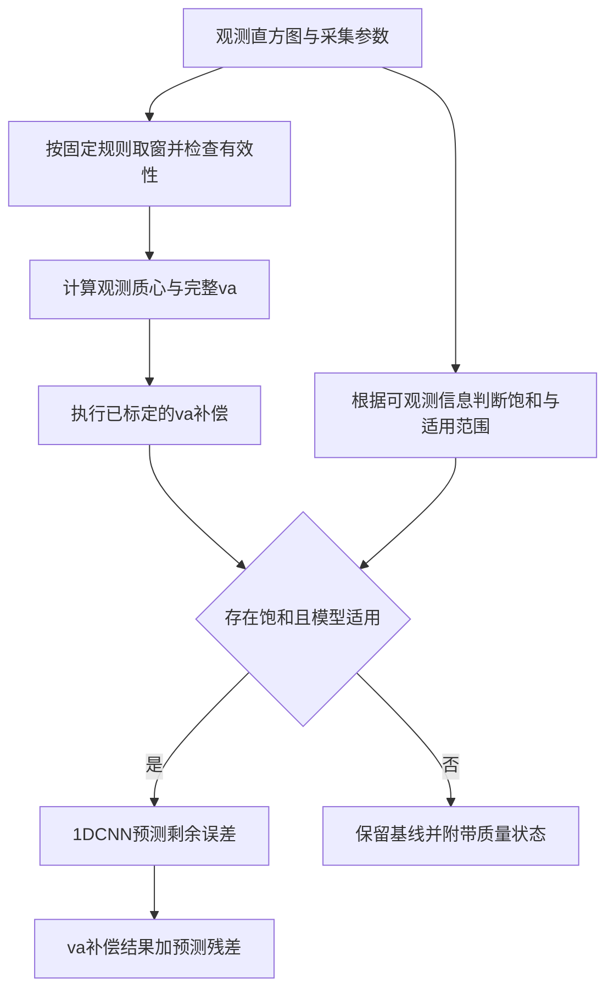

# va补偿基础上的1DCNN饱和残差补偿方案

本文在[va完整定义与质心偏移补偿推导](va补偿质心偏移推导与三种饱和状态分析10301338.md)的基础上，提出一种针对饱和回波的两阶段补偿方法：先使用经独立标定的完整va补偿，再由一维卷积神经网络读取观测直方图，估计第一阶段尚未消除的质心误差。无饱和时保留原有处理；存在饱和且模型适用时，叠加网络预测的残差补偿。

本文给出理论关系、输入设计、训练标签和验证方案。网络结构及超参数是待验证的初始设计，文中未报告模型训练结果。首先研究与原文一致的单回波、同位置子谱叠加情形，多回波目标需要另外定义定位真值。

当前项目已实现的[完整基线](../基线/README.md)包括寻峰、30-bin窗口、背景估计、逐bin扣背景并将负值置0，以及csum、ctd、完整va和近似计数snr。本文进一步讨论在该完整基线上增加经标定的va偏移补偿和1DCNN饱和残差补偿；下文“va基线”特指扩展流程中的第一阶段va补偿。当前背景与窗口规则以基线说明为准，本文原有无背景理论示例及其补偿系数保留各自的适用条件。

当前基线还要求全局最大候选峰通过SNR门限，默认下限为8且可配置。`peak_valid=False`时ctd和va为`None`，不向其他候选峰回退；这些无有效峰样本应作为检测失败单独统计，不直接进入后续质心补偿或生成有效回归特征。SNR门限与子谱饱和门控是两个不同判断，不用SNR门限代替饱和识别。

## 1 为什么在va补偿之后增加1DCNN

原文的完整va包含质心所在bin的部分计数，不能改回仅统计完整左翼bin的旧定义。对于共同统计窗口内的观测谱，va描述质心左侧计数到质心的平均距离，但它将整条直方图压缩成一个标量。

部分饱和时，不同子谱的遮蔽位置、形状和观测权重均可能变化。原文B1与B2具有相同的整体va，却需要不同的质心补偿量。因此，无论采用固定系数还是复杂的单变量函数，仅输入va都不能同时正确补偿这两种情况。

增加1DCNN的目的，是利用va未保留的序列信息，例如前沿陡度、峰顶变化、后沿衰减和多个子谱混合形成的局部形状。网络是否能够区分这些状态，需要通过训练和独立测试验证。

必须区分两个问题：相同va不代表整条直方图相同；但如果不同理想状态产生统计上无法区分的完整观测，1DCNN也不能凭空恢复丢失的信息。这里提出的是受训练分布约束的残差估计方法，而不是对任意饱和状态都可唯一反演的证明。

## 2 完整va基线与残差补偿公式

### 2.1 坐标与完整va

令观测累计直方图为$H_i$，第$i$个bin中心为$x_i=i+1/2$，共同统计窗口为$W=[a,b)$。首先计算

$$
Q_H=\sum_{i=a}^{b-1}H_i,\qquad
w_H=\frac{\sum_{i=a}^{b-1}H_i x_i}{Q_H}.
$$

令

$$
P_H=\lfloor w_H\rfloor,\qquad
f_H=w_H-P_H,\qquad
L_H=\sum_{i=a}^{P_H-1}H_i.
$$

按bin内均匀插值约定，使用原文的完整va：

$$
va_H=
\frac{
\sum_{i=a}^{P_H-1}H_i(w_H-x_i)
+\frac12 H_{P_H}f_H^2
}{L_H+H_{P_H}f_H}.
$$

所有位置和补偿量首先统一使用bin。只有$Q_H>0$且va分母非零时，才计算该特征；无有效回波或特征未定义的样本应输出无效状态，不通过添加一个极小分母把它变成有效测量。

### 2.2 第一阶段va补偿

将实际可部署的va基线写成

$$
\widehat{\Delta w}_{va}=F_{va}(va_H,\mathbf z),\qquad
w_{va}=w_H+\widehat{\Delta w}_{va}.
$$

$\mathbf z$仅包含部署时已知的工况，例如bin宽、死时间和累计周期数。对于固定回波模板及已标定工作区，可从以下形式开始：

$$
\widehat{\Delta w}_{va}=c_{va}(S_{cal}-va_H).
$$

$S_{cal}$是独立低通量参考得到的完整理想va，$c_{va}$是标定系数。若回波宽度变化，应重新标定或采用能够由可测工况选择的参数表；不能在推理时使用当前样本未知的理想谱来确定$S_{cal}$或系数。

原文的$c_A\approx9.305234432852$来自一个A配置，只能用于该配置的数值说明。将其用于其他强度或饱和状态属于待验证的基线选择，不具有已证明的通用性。

### 2.3 第二阶段学习剩余误差

令$w_{ref}$为参考质心，与$w_H$使用相同坐标和统计窗口。网络的监督标签定义为

$$
r^*=w_{ref}-w_{va}
=w_{ref}-w_H-\widehat{\Delta w}_{va}.
$$

1DCNN输出一个有符号标量：

$$
\hat r=f_\theta(\mathbf X,\mathbf z).
$$

最终结果为

$$
\boxed{
w_{final}=w_H+\widehat{\Delta w}_{va}+g\hat r
=w_{va}+g\hat r
}
$$

其中$g$为部署时根据观测信息得到的饱和门控。最初采用二值门控：已判为无饱和时$g=0$；存在饱和且质量检查通过时$g=1$。连续概率门控可以作为后续对照，但必须按实际门控重新训练和评估。

标签必须是va补偿后的剩余误差。如果将$w_{ref}-w_H$作为网络标签，再与va补偿相加，会重复补偿。残差可能为正，也可能为负，因此回归输出层使用线性输出，不使用限制非负的激活函数。

若距离标定关系为$d=s_d w+b_d$，则

$$
d_{final}=d_{va}+s_d g\hat r,
\qquad d_{va}=s_d w_{va}+b_d.
$$

此时$s_d$的单位是距离/bin。只有明确为往返飞行时间测距时，才可进一步使用$s_d=c_0\Delta t/2$；$c_0$表示光速，避免与va补偿系数混用。

## 3 不同饱和状态怎样处理

| 状态 | 第一阶段 | 网络处理 | 需要验证的内容 |
| --- | --- | --- | --- |
| 全部未饱和 | 保留已标定的va补偿或已有可靠反演流程 | $g=0$，不增加残差 | 未饱和不等于没有畸变；验证原有基线精度 |
| 部分饱和 | 计算固定版本的va基线 | $g=1$，预测剩余偏移 | 是否能通过直方图形状区分不同混合状态 |
| 全部饱和 | 先使用同一va基线进行统一比较 | 在训练覆盖且观测仍有区分信息时预测残差 | 不能仅凭全部饱和标签认定偏移恒定 |

如果全部饱和区已经独立验证存在稳定固定偏移，也可以将该分支的基线改为$w_H+d_{sat}$，然后重新定义和训练该分支的残差。它属于另一版基线，不能把固定偏移、va补偿和同一个网络输出不加区分地连续相加。

原文C配置的$7.2856179728$ bin只表示该配置所需的固定偏移，不直接作为所有全部饱和样本的统一真值。对于超出训练范围、严重截窗或缺少有效计数的输入，保留基线并附带质量状态；必要时触发低通量辅助测量，不把基线结果标为已通过网络验证。

## 4 饱和判断必须使用可观测信息

这里沿用原文的定义：饱和表示所需回波信息不能由既定反演公式可靠恢复，而不只是直方图达到某个高度。仿真中的真实光通量和真实可用概率可用于生成训练标签，但不能直接进入部署输入或门控。

若保留各子谱，且硬件符合原文的非瘫痪、逐周期复位模型，可从全时域观测计数估计

$$
\hat p_i^{(k)}=\frac{n_i^{(k)}}{N_k},\qquad
\hat a_i^{(k)}=1-\sum_{j=\max(0,i-D)}^{i-1}\hat p_j^{(k)}.
$$

结合$\hat a_i^{(k)}$、$\hat p_i^{(k)}/\hat a_i^{(k)}$、有效周期数和噪声评估，对需要恢复的区域给出可靠性标记。估计值越出物理范围时应标为不可靠，不能先截断成合法值再据此宣布可可靠反演。原文的0.02是实例中的保护阈值，正式门控阈值要按测量精度和累计次数标定。

上述计算需要裁剪窗口之前的死时间历史。若只保存50个bin的局部谱，不能默认窗口首bin之前没有触发事件；应保存至少所需的历史区间或硬件给出的可用状态。

若只保存叠加谱，各子谱饱和数量通常不能由一个整体va可靠推出。这时需要使用可用的硬件标记，或另外训练并验证饱和识别器；在没有可靠门控之前，不能把仿真真值标签代入测试来声称部署链路有效。可先做真实标签门控的上限实验，但必须与实际识别器门控的结果分开报告。

## 5 1DCNN输入与预处理

### 5.1 首版使用叠加直方图

首版以部署中能够获得的叠加谱为主要输入，不要求恢复完整理想直方图。令$L=b-a$，$E=\sum_kN_k$为各子谱累计周期数之和，构造三个长度为$L$的通道：

$$
X_{1,i}=\frac{H_i}{\max(Q_H,\varepsilon)},\qquad
X_{2,i}=\log\left(1+\frac{H_i}{E}\right),\qquad
X_{3,i}=m_i.
$$

$X_1$保留归一化形状，$X_2$保留每周期观测计数尺度，$m_i$表示该位置是否有实际采集数据。补零位置取$m_i=0$；真实采集但计数为零的位置取$m_i=1$。这里的$\varepsilon$只用于有效样本的数值计算，不改变第2节对无效输入的处理。

累计周期数不同的子谱不应简单当作等曝光测量。若硬件不能提供$E$，应明确固定曝光条件，并移除依赖未知$E$的特征，重新训练对应版本。

标量支路输入建议为

$$
\mathbf z=
[va_H,\widehat{\Delta w}_{va},\log(1+Q_H),
\log(1+E),D,\Delta t,\mathbf z_{sat}].
$$

$\mathbf z_{sat}$仅包括实际可得的饱和标记或估计置信度。训练集统计量用于特征标准化，并在推理时固定使用。仿真真值、未知理想质心和真实光通量不作为输入。首版不将绝对$w_H$输入网络，以降低固定目标位置造成的捷径学习。

### 5.2 窗口与位置变化

复核原文A、B1、B2、C时，保持原文共同窗口$[195,245)$，长度50，原有数值才可直接比较。正式数据集必须覆盖不同真实位置和亚bin相位，不能全部固定在220 bin。

部署窗口应由实际可用的粗定位规则确定，例如观测峰值附近的固定宽度窗口。训练与部署使用同一规则；每个样本的观测谱、参考谱及va基线在同一个窗口内计算。粗定位依赖观测量，不使用未知参考峰位。应验证强饱和前移时窗口仍覆盖所需的主峰和后沿。

如果从原文固定窗口改为跟随观测的窗口，必须重新计算参考质心、完整va、标定系数和残差标签。原文数值用于原窗口下的校核，不直接作为新窗口的标定参数。边界补零时使用有效位置掩码；发生明显截窗时返回质量标记。

若更换bin宽，同一卷积核对应的物理时间范围也会变化。首版固定bin宽；跨bin宽应用应统一重采样规则并重新验证，不能仅增加一个标量就假定模型自动适配。

### 5.3 如果可以保留各子谱

后续可对每条子谱采用共享的1DCNN编码器，再融合子谱特征，并保留曝光、相对计数和可靠性标记。若子谱具有固定空间编号，可以使用固定顺序；若编号本身没有物理含义，应使用对排列不敏感的聚合方式。

子谱方案有机会保留叠加时丢失的信息，应与只输入叠加谱的首版分别训练和比较。不应把仅在训练阶段可见的子谱信息作为实际模型的必要输入。

## 6 初始网络结构

网络沿时间bin方向卷积。下表是一套可直接进入实现阶段的轻量初始结构，所有卷积stride为1，使用对称零填充保持序列长度。

| 模块 | 初始设置 | 输出形状，不含batch维 |
| --- | --- | --- |
| 序列输入 | 形状、计数尺度、有效位置掩码 | $3\times L$ |
| 卷积1 | Conv1d，3到16通道，核宽5，padding=2；ReLU | $16\times L$ |
| 卷积2 | Conv1d，16到32通道，核宽5，padding=2；ReLU | $32\times L$ |
| 卷积3 | Conv1d，32到32通道，核宽3，padding=1；ReLU | $32\times L$ |
| 序列读出 | Flatten，Linear到64维；ReLU | 64 |
| 标量支路 | 标准化后Linear到16维；ReLU | 16 |
| 融合层 | 拼接为80维，Linear到32维；ReLU | 32 |
| 残差输出 | Linear到1维 | $\hat r$，单位bin |

三个卷积层的局部感受野为11个bin，Flatten后的全连接层融合整个窗口。首版保留序列位置关系，便于比较前沿、峰顶与后沿。输入长度固定；更换窗口长度后需要调整读出层并重新训练。

PyTorch的[Conv1d官方文档](https://docs.pytorch.org/docs/stable/generated/torch.nn.Conv1d.html)说明其输入组织为batch、通道和序列长度，实施时应保持该维度约定。

这里的“残差”指最终质心相对于va基线的剩余误差。网络内部不要求使用ResNet残差块；[残差学习原始论文](https://arxiv.org/abs/1512.03385)可作为学习修正量这一设计思路的参考，但其图像识别实验不构成本方案在饱和LiDAR上的有效性证据。

## 7 训练数据与参考真值

### 7.1 先复核原文，再扩展覆盖范围

首先按原文的非瘫痪递推、逐周期复位和死时间$D=120$ bin复核四个配置。完整响应在$[0,512)$生成，再取共同窗口；不能只在局部窗口内启动死时间模型。第一阶段复核保持FWHM=8 bin、每组8个子谱、每子谱40000周期、无背景等原文条件。

这四组配置用于实现核对，不足以构成训练集。随后变化子谱光通量分布、饱和子谱数量、峰位和亚bin相位，并逐步加入脉宽变化、累计周期数变化以及经硬件确认的背景和IRF变化。每个扩展维度都记录范围与采样方式，形成可追溯的数据版本。

原文前部的指数可用概率假设与后部非瘫痪递推不是同一个普遍等价模型。首版训练数据统一使用后者；如果硬件不同，应先更换并验证前向模型。

### 7.2 有限计数噪声

期望谱可以用于代数校核，但正式训练应包含实际累计周期数下的随机观测。可逐周期生成入射事件，并按照已确认的探测、死时间及复位规则累计计数，使探测历史与后续可用状态一致。

不能默认在各bin独立抽取Poisson计数就等价于SPAD死时间过程，因为死时间会使不同bin的观测相关。若为了效率采用近似噪声模型，应与事件级仿真或实测数据比较后再用于验证。

### 7.3 参考质心

仿真数据使用同一窗口内的无死时间、无随机计数噪声的理想信号谱计算$w_{ref}$。若各子谱曝光不同，理想参考也按对应曝光加权。实测数据可使用同目标、同几何条件下的独立低通量长积分参考，并检查系统时延与目标移动。

若后续加入背景，必须明确目标是信号质心还是含背景混合谱质心，且对基线、标签和评估采用同一口径。首版保持原文无背景条件，避免在尚未定义真值时混合训练目标。

参考测量存在噪声时，要记录其不确定度，避免把参考噪声解释成网络可学习的确定性残差。若要从窗口质心推广到真实飞行时间，还需另外验证窗口截断和模板不对称带来的误差。

### 7.4 数据隔离

先按物理场景、子谱光通量配置及实测目标或采集批次划分训练、验证、测试集，再生成各自的噪声重复与增强样本。同一配置的不同噪声种子、平移和亚bin扰动应留在同一数据分区，防止近似重复样本泄漏。

va系数、标准化参数和饱和识别器只能在训练侧标定，超参数与停止条件由验证集确定。冻结va基线后重新生成全部残差标签；任何基线版本变更都会改变网络学习目标。测试集不能参与参考参数调节。

特别设置不同绝对位置的测试，防止所有真值都为220 bin时，模型通过学习“输出220”获得虚假的高精度。还应保留未见过的光通量组合、脉宽和实测批次，用于评估外推和仿真到实测的差距。

## 8 损失函数与训练策略

对存在饱和的训练样本，使用Huber损失回归残差：

$$
\mathcal L_{sat}=\frac{1}{M_{sat}}
\sum_{n\in\mathcal S_{sat}}
\operatorname{Huber}_{\delta}(\hat r_n-r_n^*).
$$

其中$\mathcal S_{sat}$包含部分饱和和全部饱和样本，$M_{sat}$为样本数。Huber损失在小误差区使用二次形式，在大误差区使用线性形式，定义见[PyTorch官方文档](https://docs.pytorch.org/docs/stable/generated/torch.nn.modules.loss.HuberLoss.html)。$\delta$以bin为单位，在验证集上选择。

训练样本按饱和类别和强度分层采样，避免常见工况掩盖少量严重饱和样本。初始优化器可采用Adam，学习率从$10^{-3}$开始，依据验证集误差调整并早停；这些设置是实验起点，不是既定最优值。

无饱和样本的目标行为是保持原有基线。在实际门控为$g=0$时，输出天然满足$w_{final}=w_{va}$；也可用适度的零残差约束训练网络，使门控偶发误报时更平稳，但应单独检查它是否损害临界饱和样本的精度。

初期先固定饱和门控与va基线，只训练残差网络。若后续联合训练识别器和回归器，应同时检查误判、门控衰减和回归误差对最终结果的影响，不能只报告已知真实类别时的回归精度。

## 9 用原文B1和B2核对残差定义

为了说明“额外补偿”究竟学习什么，暂时将原文A配置的系数作为共同va基线：

$$
S_{cal}=2.730243055730,\qquad
c_{va}=9.305234432852.
$$

在原文的固定窗口和无噪声配置下，两组有

$$
va_{H,B1}=va_{H,B2}\approx2.578475899975.
$$

于是第一阶段对两组给出同一个补偿量：

$$
\widehat{\Delta w}_{va}
=c_{va}(S_{cal}-va_H)
\approx1.412228963507\ \mathrm{bin}.
$$

| 配置 | 原文所需总补偿，bin | 示例va基线补偿，bin | 应学习的额外残差，bin |
| --- | ---: | ---: | ---: |
| B1 | 8.038384037855 | 1.412228963507 | 6.626155074347 |
| B2 | 1.532937961750 | 1.412228963507 | 0.120708998243 |

如果只输入相同va及相同标定参考，网络仍然无法给出两个不同的正确残差。输入完整观测形状后，两组有机会被区分，但有限计数噪声下是否可区分，需要看独立测试结果。

这些残差是由原文数值与所选基线计算得到的监督目标，不是1DCNN预测结果，也不表示A配置的系数已经适用于饱和区域。正式训练应以原始精度数据重新生成标签。

## 10 验证指标与对照实验

对测试样本定义

$$
e_H=w_H-w_{ref},\qquad
e_{va}=w_{va}-w_{ref},\qquad
e_{final}=w_{final}-w_{ref}.
$$

在存在饱和且$g=1$时，有

$$
e_{final}=\hat r-r^*.
$$

这说明第二阶段的任务是消除剩余误差，而不是再次估计全部偏移。对于任意门控值，一般关系为$e_{final}=e_{va}+g\hat r$。

至少比较以下方法，保持同一测试集和同一参考口径：

| 方法 | 用途 |
| --- | --- |
| 原始观测质心 | 衡量未经补偿的误差 |
| 仅va补偿 | 衡量现有基线 |
| 仅用va的非线性残差回归 | 检查更复杂的单变量拟合是否仍受歧义限制 |
| 直方图直接预测总偏移 | 判断使用va基线是否带来收益 |
| va加1DCNN残差补偿 | 目标方法，使用实际部署门控 |
| va加1DCNN并使用真实类别门控 | 仅作为识别误差被移除后的上限对照 |
| 可用时的子谱模型或固定饱和偏移 | 检查增加信息或简化模型的收益 |

分别报告未饱和、部分饱和、全部饱和的平均偏差、MAE、RMSE、绝对误差95分位数和超出应用容差的比例。补充按光通量、饱和数量、脉宽和累计周期数分组的结果，以及网络参数量、推理时延和有效输出比例。

同时报告网络相对于va基线的改善比例和退化比例。质量筛选后剔除的样本单独统计，防止仅保留容易样本使误差看起来下降。不同模型使用相同的数据划分、参考测量和质量统计规则。

重点测试三类问题：B1与B2附近的同va样本能否被区分；实际饱和识别器误报和漏报是否损害最终精度；全部饱和时性能提升来自可观测信息还是仅来自狭窄训练先验。验收阈值应由应用的距离精度与有效率要求设定，不预先编造性能提升数值。

## 11 推理流程与实现顺序

无有效回波、va未定义或严重截窗时，在有效性检查阶段退出，并输出对应状态。对于有效样本，网络始终读取观测直方图；第一阶段只是修正质心标量，不要求先平移或改写直方图。

实现时先完成以下顺序：

1. 复核原文四个配置的质心、完整va及数值残差，确认坐标、窗口与补偿符号。
2. 固定采集假设与可用输入，标定va基线和可部署的饱和门控。
3. 生成包含位置、光通量配置和噪声变化的分组数据，按冻结基线生成残差标签。
4. 训练首版叠加谱1DCNN，完成同va样本测试和实际门控评估。
5. 使用独立低通量参考做实测验证，再决定是否加入子谱支路或全部饱和专用基线。

模型发布时应同时保存权重、va参数、窗口规则、输入通道定义、标准化参数、bin宽、死时间模型、门控阈值和训练覆盖范围。推理记录建议包含$w_H$、$va_H$、$\widehat{\Delta w}_{va}$、$g$、$\hat r$、$w_{final}$及质量状态，便于区分基线失配、门控误判与网络误差。
