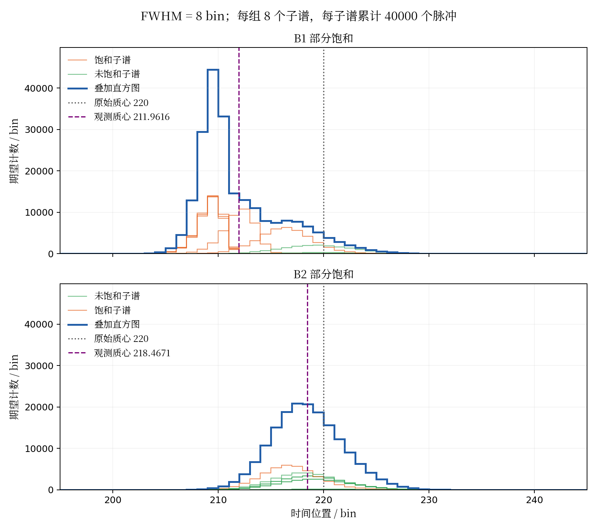
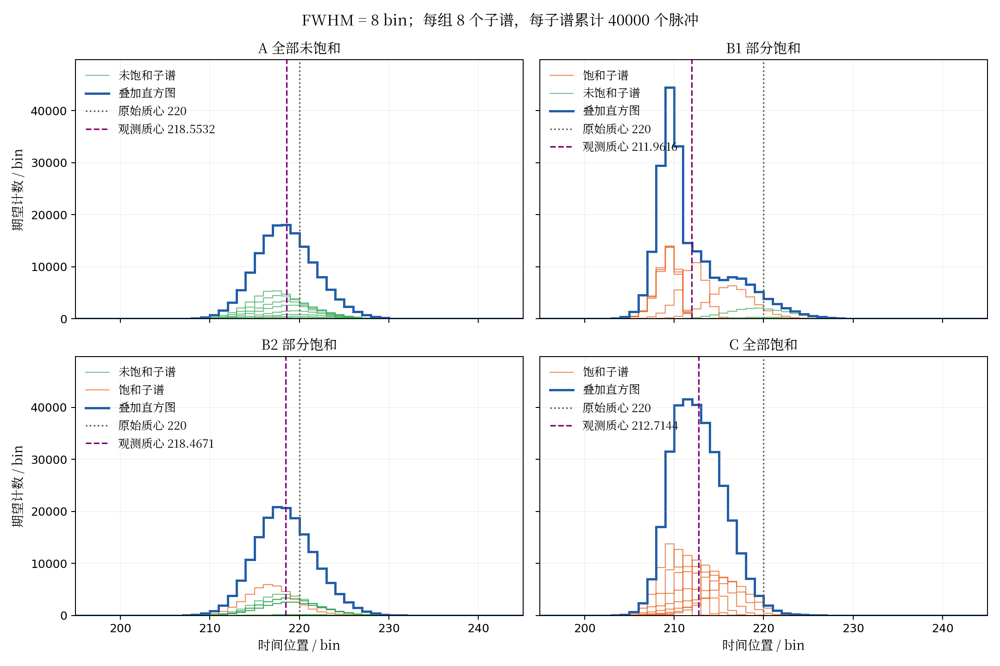

# va完整定义与质心偏移补偿推导

本文将质心所在bin的部分计数纳入va定义，重新梳理从探测概率、保留率、质心变化到va补偿的完整过程，并讨论三种子直方图状态。完整定义下，理想谱与观测谱各自以自身质心作为左翼终点，因而推导除探测损失项外，还必须包含左翼终点移动项。文末用同va而不同偏移的离散极限反例说明部分饱和时的非唯一性及其适用边界。

## 1 约定与饱和定义

第i个bin对应区间\[i,i+1)，中心为xᵢ=i+1/2；所有谱使用共同窗口\[a,b)。λᵢ表示每周期平均可探测光子数，N表示累计周期数，Hᵢ表示期望观测计数，τ表示死时间跨越的bin数。以下恒等式首先针对期望谱成立，实际计数另受随机噪声影响。窗口内总量和相关左翼总量必须非零。

本文按反演可用性定义饱和：不能使用既定反演公式可靠恢复所需回波信息的子直方图，判为饱和；能够可靠反演的，判为未饱和。“不能可靠反演”包括公式无有效定义，或可用概率过低、误差放大而不满足可信度要求，不只是程序能否输出数值。具体阈值由模型及精度要求确定，本文不预设数值。

三种状态以子直方图为单位：全部未饱和指所有子谱均可可靠反演；部分饱和指有的可反演、有的不可反演；全部饱和指所有子谱均不可可靠反演。饱和子谱仍可能保留可信前沿。全部饱和后的稳定形状是附加条件，不能仅从“不可反演”直接推出。

## 2 va的完整定义

### 2.1 从离散计数到区间内均匀密度

对任意直方图Qᵢ，假设每个bin内的计数均匀分布。以bin为时间单位时，可定义分段常数密度

$$
q(x) = Q_{i},\quad\quad x \in \lbrack i,i + 1).
$$

（1）

这是一种bin内插值约定，不表示真实光子密度在bin内必然均匀。它使完整bin的一阶矩仍然等于中心位置乘以计数。全窗质心为

$$
w_{Q} = \frac{\int_{a}^{b}xq(x)\, dx}{\int_{a}^{b}q(x)\, dx} = \frac{\sum_{i = a}^{b - 1}Q_{i}x_{i}}{\sum_{i = a}^{b - 1}Q_{i}}.
$$

（2）

定义截止位置t对应的左翼总量和左翼质心：

$$
M_{Q}(t) = \int_{a}^{t}q(x)\, dx,\quad\quad c_{Q}(t) = \frac{\int_{a}^{t}xq(x)\, dx}{M_{Q}(t)}.
$$

（3）

### 2.2 完整va的积分形式

本文此后统一用va表示包含部分bin计数的完整定义：

$$
va_{Q} = w_{Q} - c_{Q}\left( w_{Q} \right) = \frac{\int_{a}^{w_{Q}}\left( w_{Q} - x \right)q(x)\, dx}{\int_{a}^{w_{Q}}q(x)\, dx}.
$$

（4）

va表示质心左侧所有计数到质心的平均距离，而不是绝对位置。若横坐标单位为bin，则va单位也为bin；若转为LSB，应统一换算所有位置量。整体平移且窗口不截断时，连续表达的va不变；离散重采样可能引入额外误差。

### 2.3 完整va的离散计算形式

令质心所在bin及其小数部分为

$$
P_{Q} = \lfloor w_{Q}\rfloor,\quad\quad f_{Q} = w_{Q} - P_{Q},\quad\quad 0 \leq f_{Q} < 1.
$$

（5）

完整左翼bin的计数及质心分别为

$$
L_{Q} = \sum_{i = a}^{P_{Q} - 1}Q_{i},\quad\quad c_{Q,full} = \frac{\sum_{i = a}^{P_{Q} - 1}Q_{i}x_{i}}{L_{Q}}.
$$

（6）

当$L_{Q}$为零时，式（6）的质心不定义，但只要质心左侧的累计总量非零，以下不使用该商的直接计算式仍然可用：

$$
va_{Q} = \frac{\sum_{i = a}^{P_{Q} - 1}Q_{i}\left( w_{Q} - x_{i} \right) + \frac{1}{2}Q_{P_{Q}}f_{Q}^{2}}{L_{Q} + Q_{P_{Q}}f_{Q}}.
$$

（7）

当$L_{Q}$大于零时，也可以写为

$$
va_{Q} = \frac{L_{Q}\left( w_{Q} - c_{Q,full} \right) + \frac{1}{2}Q_{P_{Q}}f_{Q}^{2}}{L_{Q} + Q_{P_{Q}}f_{Q}}.
$$

（8）

质心所在bin中，区间$\lbrack P_{Q},w_{Q})$长为$f_{Q}$，按均匀假设包含$Q_{P_{Q}}f_{Q}$个计数；这些计数到质心的平均距离为$f_{Q}/2$，所以分子增加$Q_{P_{Q}}f_{Q}^{2}/2$，分母增加$Q_{P_{Q}}f_{Q}$。“半格项”中的1/2来自区间的平均距离，不是固定补偿半个bin。理想谱与观测谱各自使用自身的P和f，这正是后续必须考虑终点变化的原因。

## 3 从探测概率到保留率

沿用给定观测模型，本bin开始时处于死时间内的概率及可用概率为

$$
S_{i} = 1 - \exp\left( - \sum_{j = i - \tau}^{i - 1}\lambda_{j} \right),\quad\quad A_{i} = 1 - S_{i}.
$$

（9）

当前bin至少有一个光子的概率为1−exp(−λᵢ)。按给定模型，探测概率与期望观测为

$$
p_{i} = A_{i}\left( 1 - e^{- \lambda_{i}} \right),\quad\quad H_{i} = Np_{i}.
$$

（10）

式（9）在本文作为给定假设使用，不在此证明其与具体硬件死时间过程等价。后续代数正确不等于该概率模型已获物理验证。

定义保留率与相对损失：

$$
\eta_{i} = \frac{H_{i}}{N\lambda_{i}} = \frac{p_{i}}{\lambda_{i}},\quad\quad\delta_{i} = 1 - \eta_{i}.
$$

（11）

因此

$$
\eta_{i} = \exp\left( - \sum_{j = i - \tau}^{i - 1}\lambda_{j} \right)\frac{1 - e^{- \lambda_{i}}}{\lambda_{i}},\quad\quad H_{i} = N\lambda_{i}\eta_{i}.
$$

（12）

对λ、H作相同的bin内均匀延拓，得到密度ℓ(x)、h(x)，并令η(x)、δ(x)在每个bin内取对应常数。于是有h(x)=Nℓ(x)η(x)。λᵢ为零的bin不参与以理想谱为权重的统计；假定观测与理想输入满足此重新加权关系，不额外加入未建模计数。

## 4 全窗质心偏移

以理想密度归一化定义分布π：

$$
d\pi(x) = \frac{\ell(x)\, dx}{\int_{a}^{b}\ell(u)\, du}.
$$

（13）

这里$E_{\pi}\lbrack u\rbrack$表示按分布π计算的均值，${Cov}_{\pi}(x,u) = E_{\pi}\lbrack xu\rbrack - E_{\pi}\lbrack x\rbrack E_{\pi}\lbrack u\rbrack$表示协方差。理想与观测质心分别为

$$
w_{\lambda} = E_{\pi}\lbrack x\rbrack,\quad\quad w_{H} = \frac{E_{\pi}\lbrack x\eta\rbrack}{E_{\pi}\lbrack\eta\rbrack}.
$$

（14）

二者相减，并利用η=1−δ，可得

$$
w_{H} - w_{\lambda} = \frac{{Cov}_{\pi}(x,\eta)}{E_{\pi}\lbrack\eta\rbrack} = - \frac{{Cov}_{\pi}(x,\delta)}{E_{\pi}\lbrack\eta\rbrack}.
$$

（15）

定义前移量Δw为理想质心减去观测质心：

$$
\Delta w = w_{\lambda} - w_{H} = \frac{{Cov}_{\pi}(x,\delta)}{E_{\pi}\lbrack\eta\rbrack} \equiv G_{\pi}.
$$

（16）

该恒等式未使用小损失近似。完整bin的积分均值等于bin中心，所以与离散全窗质心推导一致。

## 5 共同左翼内的重新加权效应

实际va的左翼终点随各自质心改变，不能直接把两个不同左翼上的差写成同一个协方差。先固定共同终点$t_{0} = w_{\lambda}$，定义共同左翼$L_{0} = \lbrack a,w_{\lambda})$，并将理想密度限制在该区间内归一化。这里的共同左翼已包含理想质心所在bin的部分区间。

在同一范围内重复全窗推导：

$$
c_{H}\left( w_{\lambda} \right) - c_{\lambda}\left( w_{\lambda} \right) = - \frac{{Cov}_{L_{0}}(x,\delta)}{E_{L_{0}}\lbrack\eta\rbrack} \equiv - G_{L_{0}}.
$$

（17）

这是同一统计区间内，由各位置保留率不同引起的左翼质心变化。 $G_{L_{0}}$与旧版仅完整bin左翼的$G_{L}$一般不同，不可直接混用。

## 6 左翼终点移动效应

理想va使用终点$w_{\lambda}$，观测va使用终点$w_{H}$。定义同一条观测谱在两个截止位置之间的左翼质心差：

$$
B = c_{H}\left( w_{H} \right) - c_{H}\left( w_{\lambda} \right).
$$

（18）

因此

$$
c_{H}\left( w_{H} \right) - c_{\lambda}\left( w_{\lambda} \right) = - G_{L_{0}} + B.
$$

（19）

B不是新的物理损失，而是统计范围改变带来的贡献。当观测质心前移时，左翼终点也向左移，移除了靠近旧终点的计数；对非负密度，$c_{H}(t)$随t不减，所以在两个左翼质心均有定义时，必有$B \leq 0$。

令J(t)=⌊t⌋、r(t)=t−J(t)，B可用以下累计量直接计算，不必进行数值积分：

$$
M_{H}(t) = \sum_{i = a}^{J(t) - 1}H_{i} + H_{J(t)}r(t),
$$

（20）

$$
T_{H}(t) = \sum_{i = a}^{J(t) - 1}H_{i}x_{i} + H_{J(t)}\left\lbrack J(t)r(t) + \frac{1}{2}r(t)^{2} \right\rbrack.
$$

（21）

有$c_{H}(t) = T_{H}(t)/M_{H}(t)$，分别取$t = w_{H}$和$t = w_{\lambda}$即可得到B。累计量分母必须非零。这里J(t)为终点所在bin编号，a为固定窗口左端。

## 7 完整va的补偿关系

由完整定义，

$$
va_{\lambda} = w_{\lambda} - c_{\lambda}\left( w_{\lambda} \right),\quad\quad va_{H} = w_{H} - c_{H}\left( w_{H} \right).
$$

（22）

相减并代入式（19），得到无需比值定义的基本恒等式：

$$
\Delta va \equiv va_{\lambda} - va_{H} = \Delta w - G_{L_{0}} + B.
$$

（23）

当Δw非零时定义共同左翼比例因子

$$
\kappa_{0} = 1 - \frac{G_{L_{0}}}{\Delta w}.
$$

（24）

于是

$$
\Delta va = \kappa_{0}\Delta w + B.
$$

（25）

令$S = va_{\lambda}$，当κ₀非零时，严格补偿关系为

$$
\Delta w = \frac{S - va_{H} - B}{\kappa_{0}},\quad\quad w_{fix} = w_{H} + \frac{S - va_{H} - B}{\kappa_{0}}.
$$

（26）

也可将终点项吸收到有效系数中：

$$
\kappa_{eff} = \kappa_{0} + \frac{B}{\Delta w} = \frac{\Delta va}{\Delta w}.
$$

（27）

当有效系数非零时，恢复简洁形式

$$
\Delta w = \frac{S - va_{H}}{\kappa_{eff}}.
$$

（28）

这里的有效系数同时包含损失重新加权与左翼终点移动效应，不能直接沿用旧版纯定义的κ。若距离换算为$dis = s_{d}w_{H} + b_{d}$，其中$s_{d}$为距离换算系数、$b_{d}$为距离截距，则

$$
dis_{fix} = dis + \frac{s_{d}}{\kappa_{eff}}\left( S - va_{H} \right).
$$

（29）

Δw为零时，应使用式（23），不计算含Δw作分母的比例因子；有效系数为零时，不能按式（28）反解。

## 8 恒等式与实际补偿的区别

式（26）是严格关系，但B的计算需要理想质心$w_{\lambda}$，而它往往正是未知量；κ₀同样依赖理想回波。因此它并未直接给出仅输入观测va就能独立计算的算法。若将S、B或有效系数都从同一组已知理想谱与观测谱计算后再反解，验证的是恒等式及实现的一致性。

实际使用时，应从独立参考、物理模型或标定得到可用参数，或在给定回波族上建立从可测特征到偏移的单值映射。采用式（28）时，需要按完整va口径重新标定有效系数，并在未参与标定的数据上验证。若所有允许状态中同va仍对应不同偏移，则单变量补偿不可唯一成立。

## 9 三种子直方图状态

### 9.1 全部未饱和

所有子谱都能可靠反演。若它们处于共同线性响应区，叠加后近似只缩放幅度，偏移接近零，基本无需补偿。按本文定义，未饱和并不必然意味着畸变很小；可优先通过反演估计理想质心，也可在受约束范围内标定完整va补偿。未饱和本身不保证有效系数恒定。

### 9.2 部分饱和

有的子谱可以可靠反演，有的不能。各自的响应、形状变化与观测权重不同，整体va的变化同时混合了这些因素。固定系数补偿可能失配；若不同状态给出相同va而偏移不同，则任何仅输入va的确定性补偿都不能同时精确命中。

部分饱和不意味着任何va方法都必然失败。若回波形状、空间强度分布等受充分约束，仍可能存在稳定的非线性补偿映射。必须在明确允许变化的模型范围内检验。

### 9.3 全部饱和且形状稳定

所有子谱均不可可靠反演。若各子谱饱和后趋于相同且对齐的归一化形状，或不同形状的观测混合权重稳定，则整体观测形状及完整va可趋于稳定。若理想形状及相对位置关系也稳定，质心偏移可趋于固定值，可直接采用固定偏移补偿。

$$
va_{H} \rightarrow va_{sat},\quad\quad\Delta w \rightarrow \Delta w_{sat},\quad\quad w_{fix} = w_{H} + \Delta w_{sat}.
$$

（30）

只有观测形状稳定，不能单独保证偏移稳定，因为理想质心也参与偏移定义。单个稳定饱和点也不能确定覆盖整个强度范围的补偿斜率。

## 10 FWHM为8bin时同va不同偏移的反例

### 10.1 统一条件与正向计算

本例与第12节统一使用FWHM=8bin、中心220bin的连续高斯模板，标准差σ≈3.3972872012bin。每个子谱由该高斯在bin区间内积分得到理想形状f，全部使用相同模板与位置，仅光通量A不同。

$$
f_{i} = \Phi\left( \frac{i + 1 - 220}{\sigma} \right) - \Phi\left( \frac{i - 220}{\sigma} \right),\quad\quad\lambda_{i}^{(k)} = A_{k}f_{i}.
$$

（31）

完整响应在\[0,512)计算，全部质心及完整va均在同一个峰值窗口\[195,245)计算，不分别跟随观测峰移动窗口。该窗口以共同原始模板峰位220bin为中心，前后各25bin，总计50bin；包含编号195至244的50个bin。这里不按各组移动后的观测峰分别取窗，以保持同窗口比较。该范围覆盖各子谱及叠加谱的主峰和前后沿，极小尾部被截去。每组8个独立子谱，每个子谱累计40000个脉冲；逐周期复位，无背景、无后脉冲、无TDC事件数限制。

采用非瘫痪死时间D=120bin，一次探测后接下来的D个bin不可用。对每个子谱分别计算

$$
a_{i} = 1 - \sum_{j = \max(0,i - D)}^{i - 1}p_{j},\quad\quad p_{i} = a_{i}\left( 1 - e^{- \lambda_{i}} \right).
$$

（32）

观测计数为H=40000Σp⁽ᵏ⁾。第3节的指数可用概率是原附件给定假设，本节使用非瘫痪递推，不宣称二者对所有回波等价。重新加权与完整va恒等式适用于本节模型。以下B1和B2对应第12节同名配置。

### 10.2 参数与饱和分类

| **子谱编号** |   **B1光通量**    |   **B2光通量**    |
|:------------:|:-----------------:|:-----------------:|
|      1       |  70.124054156928  | 0.035914466624341 |
|      2       | 0.067762437342051 |  1.1370595373827  |
|      3       |  873.20389471306  | 0.77787007587299  |
|      4       |  827.10744445288  |  1.1370595373827  |
|      5       | 0.57724678906566  |  3.9583946914913  |
|      6       |       0.02        |  1.6621084055741  |
|      7       |  783.44442668133  | 0.77787007587299  |
|      8       |  4.7858288763314  | 0.033480387208001 |

B1的第1、3、4、7、8个子谱在窗口内可用概率低于0.02，按既定保护判据归为饱和；B2仅第5个子谱越界。因此两组均属于部分饱和。阈值是操作性可靠性判据，需与所需恢复区域、采集次数和噪声要求结合使用；各子谱越界位置详见第13节。

|    **结果**    |     **B1**     |     **B2**     |
|:--------------:|:--------------:|:--------------:|
| 窗口内理想质心 |      220       |      220       |
| 窗口内观测质心 | 211.9616159621 | 218.4670620383 |
|   完整观测va   | 2.578475899975 | 2.578475899975 |
|    质心偏移    |  8.0383840379  |  1.5329379617  |
|  饱和子谱数量  |      5/8       |      1/8       |

表中光通量为每周期理想可探测光子数，位置量单位为bin。使用未舍入参数时两组va差小于10⁻¹⁰bin，表格显示舍入可能引入微小复现差异。

### 10.3 直方图对比

<figure>

<figcaption aria-hidden="true">
FWHM为8bin时两组部分饱和混合的子谱和叠加谱
</figcaption>
</figure>

图中仅显示子直方图、叠加直方图和质心标线。绿色细线为未饱和子谱，橙色细线为饱和子谱，蓝色粗线为8条子谱之和。纵轴为40000个脉冲累计的期望计数，不作归一化；灰色点线为共同原始质心220bin，紫色虚线为观测质心。两图采用相同坐标范围，各主峰均完整显示。

### 10.4 结果与结论

两组完整va相同，但质心偏移相差

$$
\Delta w_{B1} - \Delta w_{B2} \approx 8.0383840379 - 1.5329379617 = 6.5054460761\ bin.
$$

（33）

两组理想归一化形状和理想va均相同，差别仅在空间光通量配置。因此在固定模板、共同峰值窗口及同一死时间模型下，整体va仍不足以唯一确定部分饱和混合状态的偏移。这只说明va标量存在歧义，不意味着整条直方图也无法区分。结论针对无噪声期望谱，未验证背景、有限脉冲随机误差与实际IRF失配。

## 11 结论

完整va应按式（4）或式（7）计算。将质心所在bin的部分计数纳入后，必须同时处理各谱左翼终点随自身质心移动的贡献B。严格关系为$\Delta va = \Delta w - G_{L_{0}} + B$；也可将B吸收到重新定义的有效系数中，保留$\Delta w = \left( S - va_{H} \right)/\kappa_{eff}$的形式。

三种状态都不被恒等式排除，但是否能用整体va实施唯一、稳定的补偿，需要明确形状和混合状态的约束。全部未饱和可优先反演；部分饱和需检验混合歧义；全部饱和且理想和观测形状均稳定时，可使用固定偏移补偿。所有参考值、系数及示例都必须与完整va口径一致。

## 12 FWHM为8bin时三种状态的参数与直方图

本节统一使用连续高斯半高全宽FWHM=8bin，对应标准差为

$$
\sigma = \frac{8}{2\sqrt{2\ln 2}} \approx 3.3972872012\ bin.
$$

（34）

1bin是计算时间网格，FWHM指bin积分离散化前的连续高斯宽度。所有子谱使用相同模板、中心220和相同亚bin相位，仅改变光通量。完整响应在\[0,512)计算，死时间120bin、逐周期复位，无背景、无后脉冲、无TDC事件数上限；使用第10节的非瘫痪递推。所有质心和完整va均在共同窗口\[195,245)计算，窗口以原始模板峰位220bin为中心，前后各25bin，共50bin，覆盖各谱主峰；不随观测峰移动。

A表示全部未饱和，B表示部分饱和，C表示全部饱和；B1和B2为B类内部两组不同参数，不是不同饱和类别。每组包含8个独立子谱，每子谱累计40000个脉冲，纵轴为期望计数，叠加谱是8条子谱的计数之和。第10节的B1、B2与本节使用相同参数及同一FWHM为8bin的模板。此前FWHM为1bin的临时搜索结果已从本版实例中移除。

### 12.1 全部未饱和与全部饱和的光通量

| **子谱编号** | **A状态光通量** | **C状态光通量** |
|:------------:|:---------------:|:---------------:|
|      1       |      0.05       |        5        |
|      2       |       0.1       |        8        |
|      3       |       0.2       |       15        |
|      4       |       0.4       |       30        |
|      5       |       0.8       |       60        |
|      6       |       1.2       |       120       |
|      7       |        2        |       300       |
|      8       |        3        |       800       |

按窗口内最小可用概率小于0.02的操作判据，A的8个子谱均未触发保护，C的8个子谱均触发保护。C仅表示全部不能可靠反演，并不自动代表各子谱都已达到同一个极限形状或偏移已不再随强度变化。

### 12.2 部分饱和的两组光通量

| **子谱编号** |   **B1光通量**    |   **B2光通量**    |
|:------------:|:-----------------:|:-----------------:|
|      1       |  70.124054156928  | 0.035914466624341 |
|      2       | 0.067762437342051 |  1.1370595373827  |
|      3       |  873.20389471306  | 0.77787007587299  |
|      4       |  827.10744445288  |  1.1370595373827  |
|      5       | 0.57724678906566  |  3.9583946914913  |
|      6       |       0.02        |  1.6621084055741  |
|      7       |  783.44442668133  | 0.77787007587299  |
|      8       |  4.7858288763314  | 0.033480387208001 |

B1中第1、3、4、7、8个子谱饱和；B2中仅第5个子谱饱和。B2的第1个光通量通过一维求根微调，使两组完整va匹配。表格显示位数有限，用舍入参数复现时可能产生微小差异。

### 12.3 三种状态的计算结果

|   **配置**   |         **观测质心与偏移**         |    **完整va与饱和数量**    |
|:------------:|:----------------------------------:|:--------------------------:|
| A 全部未饱和 | 质心218.553230261；偏移1.446769739 | va=2.574763927398；0/8饱和 |
| B1 部分饱和  | 质心211.961615962；偏移8.038384038 | va=2.578475899975；5/8饱和 |
| B2 部分饱和  | 质心218.467062038；偏移1.532937962 | va=2.578475899975；1/8饱和 |
|  C 全部饱和  | 质心212.714382027；偏移7.285617973 | va=2.25199190099；8/8饱和  |

四组理想归一化形状相同，窗口内理想质心均为220bin，理想va约为2.730243055730bin。B1和B2的完整观测va均约为2.578475899975bin，数值差小于10⁻¹⁰bin，但偏移相差

$$
\Delta w_{B1} - \Delta w_{B2} \approx 8.0383840379 - 1.5329379617 = 6.5054460761\ bin.
$$

（35）

这证明在本例固定模板、共同窗口和同一死时间模型下，部分饱和混合中的整体va不唯一决定偏移。它不意味着两组整条直方图无法区分；本结果针对无噪声期望谱，尚未验证有限脉冲噪声、背景或IRF失配。

### 12.4 子谱与叠加谱对比

<figure>

<figcaption aria-hidden="true">
FWHM为8bin时三种状态的子谱和叠加谱
</figcaption>
</figure>

绿色细线为未饱和子谱，橙色细线为饱和子谱，蓝色粗线为叠加谱。多条子谱允许重叠。灰色点线为原始质心220bin，紫色虚线为观测质心。四幅图横纵轴范围相同，纵轴是40000个脉冲累计的期望计数，不作归一化。未饱和不等于无畸变；全部饱和也不自动等于固定偏移。

## 13 子谱怎样进入不能可靠反演的状态

### 13.1 反演公式与失效原因

由单子谱探测概率关系p=a(1−exp(−λ))可得

$$
q_{i} = \frac{p_{i}}{a_{i}},\quad\quad\lambda_{i} = - \ln\left( 1 - \frac{p_{i}}{a_{i}} \right).
$$

（36）

反演要求a大于0且0≤p/a\<1。前沿探测使SPAD进入死时间，a下降；后续即使有强输入，也可能缺少有效探测机会。当a接近零，除法和统计误差放大；当q接近1，不同较大λ对应几乎相同的触发概率。暂时固定a时的局部灵敏度为

$$
\frac{\partial\lambda_{i}}{\partial p_{i}} = \frac{1}{a_{i} - p_{i}} = \frac{1}{a_{i}\left( 1 - q_{i} \right)}.
$$

（37）

所以a很小或q接近1都可能使反演不可靠。无噪声无限精度下，小但非零a仍可能形式上反演，不能把操作性阈值分类说成严格数学无解。本节采用a\<0.02作为可用状态保护判据：在共同窗口内有需恢复区域触发阈值时，将子谱归为饱和；具体精度要求还应结合采集次数和噪声确定。

### 13.2 FWHM为8bin时各子谱的越界位置

下表中a_min为\[195,245)内最小可用概率，首次越界bin为a首次低于0.02的位置。光通量和概率为显示舍入值；接近零表示数值计算已无法分辨极小可用概率，不应解释成精确数学上为零。

| **子谱** | **光通量** | **a_min** | **首次越界bin** |
|:--------:|:----------:|:---------:|:---------------:|
|  A子谱1  |    0.05    | 0.951229  |       无        |
|  A子谱2  |    0.1     | 0.904837  |       无        |
|  A子谱3  |    0.2     | 0.818731  |       无        |
|  A子谱4  |    0.4     | 0.670320  |       无        |
|  A子谱5  |    0.8     | 0.449329  |       无        |
|  A子谱6  |    1.2     | 0.301194  |       无        |
|  A子谱7  |     2      | 0.135335  |       无        |
|  A子谱8  |     3      | 0.049787  |       无        |
| B1子谱1  |  70.1241   |   接近0   |       215       |
| B1子谱2  | 0.0677624  | 0.934482  |       无        |
| B1子谱3  |  873.204   |   接近0   |       212       |
| B1子谱4  |  827.107   |   接近0   |       212       |
| B1子谱5  |  0.577247  | 0.561442  |       无        |
| B1子谱6  |    0.02    | 0.980199  |       无        |
| B1子谱7  |  783.444   |   接近0   |       212       |
| B1子谱8  |  4.78583   | 0.008347  |       224       |
| B2子谱1  | 0.0359145  | 0.964723  |       无        |
| B2子谱2  |  1.13706   | 0.320761  |       无        |
| B2子谱3  |  0.77787   | 0.459383  |       无        |
| B2子谱4  |  1.13706   | 0.320761  |       无        |
| B2子谱5  |  3.95839   | 0.019094  |       228       |
| B2子谱6  |  1.66211   | 0.189739  |       无        |
| B2子谱7  |  0.77787   | 0.459383  |       无        |
| B2子谱8  | 0.0334804  | 0.967074  |       无        |
|  C子谱1  |     5      | 0.006738  |       223       |
|  C子谱2  |     8      | 0.000335  |       220       |
|  C子谱3  |     15     | 0.000000  |       218       |
|  C子谱4  |     30     |   接近0   |       217       |
|  C子谱5  |     60     |   接近0   |       215       |
|  C子谱6  |    120     |   接近0   |       214       |
|  C子谱7  |    300     |   接近0   |       213       |
|  C子谱8  |    800     |   接近0   |       212       |

A状态所有子谱在窗口内可用概率均未低于阈值。B1的5个强子谱和B2的1个强子谱在不同位置越界，说明“部分饱和”内部仍包含不同的遮蔽位置及混合权重。C状态全部越界，但各子谱光通量从5至800不等，故它们不必具有相同的极限观测形状。

B1的首次越界位置为子谱1在bin215、子谱3在bin212、子谱4在bin212、子谱7在bin212、子谱8在bin224。B2的首次越界位置为子谱5在bin228。这些越界位置应与需要恢复的主峰和后沿范围一起判断；若任务只要求局部前沿定位，应据任务范围重定饱和判据，不能直接套用整窗标签。对不可信区域不应把缺失计数解释成零光子输入。

## 14 三种状态的补偿参数与最终结论

本节在FWHM=8bin、共同窗口\[195,245)、原始质心220bin以及第12节所列参数下，给出A的va补偿系数、B的不可唯一补偿结论及C的固定偏移。完整理想va为

$$
S = va_{\lambda} = 2.730243055730\ bin.
$$

（38）

### 14.1 A情况采用va系数补偿

A为全部子谱可以可靠反演的配置。当前实例的观测质心为218.553230261461bin，完整观测va为2.574763927398bin。定义乘法补偿系数c_A，使

$$
w_{fix} = w_{H} + c_{A}\left( S - va_{H} \right).
$$

（39）

于是

$$
c_{A} = \frac{220 - 218.553230261461}{2.730243055730 - 2.574763927398} \approx 9.305234432852.
$$

（40）

这里采用未舍入数值计算系数，式中仅显示有限小数。对应的有效比例因子为

$$
\kappa_{eff,A} = \frac{1}{c_{A}} \approx 0.107466395092.
$$

（41）

检验可得：va减少约0.155479128331bin，乘以c_A后补偿约1.446769738539bin，观测质心恢复至220bin。所有坐标量均用bin时，c_A为无量纲。

因此，A情况可以采用经过标定的va系数补偿；本例的系数为9.305234432852。该值是当前一个配置相对于理想参考得到的比例系数，不是已经验证的整个未饱和区统一斜率。未饱和仅保证反演可用，不能单凭该标签推出系数恒定。应用到其他光通量或空间分布前，仍需独立验证；必要时可使用分段系数或直接物理反演。

### 14.2 B情况仅凭整体va无法唯一补偿

B为部分子谱不可可靠反演的混合配置。已经得到两组同模板、同位置、同窗口和同死时间的反例：

$$
va_{H,B1} = va_{H,B2} \approx 2.578475899975\ bin,
$$

（42）

但B1需要补偿8.0383840378545bin，B2只需补偿1.53293796175bin，两者相差约6.505446076105bin。它们的理想参考S也相同。

因此，只输入整体va与共同S的确定性补偿函数，对两组只能给出同一个结果，不可能同时得到两个不同的正确补偿量。这不是简单地换一个固定系数就能解决的问题；仅将单变量拟合改得更复杂，也不能消除同输入对应不同真值的歧义。

结论是：B情况在本例允许的子谱光通量变化范围内，不能仅凭整体va唯一补偿。不能将此表述为“任何方法都无法补偿”；可以增加子谱信息、其他可测形状特征、低通量辅助测量或经过验证的先验，使状态有机会被区分。va非唯一也不等于整条直方图非唯一。

### 14.3 C情况采用固定偏移补偿

C为全部子谱不可可靠反演的配置。当前实例的观测质心为212.7143820272bin，因此所需偏移为

$$
d_{C} = 220 - 212.7143820272 = 7.2856179728\ bin.
$$

（43）

相应补偿公式为

$$
w_{fix} = w_{H} + 7.285617972800.
$$

（44）

代入当前实例后，补偿质心恢复至220bin。该方法不需要使用观测va计算当前补偿量。

因此，对当前C配置可以使用固定偏移7.2856179728bin。若要将其作为整个全部饱和区的通用常数，需要验证理想形状、相对位置、饱和观测形状及混合权重的稳定性。全部不可反演本身并不能证明这些条件成立；本例仅计算出一个C配置所需的固定偏移，尚未完成跨光通量的稳定性验证。

### 14.4 最终结论

| **状态** | **当前实例的处理** | **适用边界** |
|:--:|:--:|:--:|
| A 全部未饱和 | va系数补偿，c_A≈9.305234432852 | 推广前验证系数稳定性 |
| B 部分饱和 | 整体va不能唯一确定偏移 | 需要增加区分状态的信息 |
| C 全部饱和 | 固定偏移补偿，d_C≈7.2856179728bin | 通用固定值需验证形状与混合稳定性 |

本研究实例支持的处理思路为：A采用经标定的va系数，B不能仅靠整体va补偿，C在稳定饱和形状条件下采用固定偏移。上述数值为当前配置的计算结果，不能不经验证跨工况直接共用。三种状态的识别也需要独立依据，不能仅凭一个整体va自动推断子谱饱和数量。

## 15 非饱和且背景可加时ctd和va的背景扣除

本节补充含背景的输入处理。采用不考虑饱和及死时间非线性的线性近似，设期望观测为$H_i=gs_i+\beta$，其中$s_i$为回波信号，$g>0$为公共增益，$\beta\ge0$为每bin背景期望计数。该近似是本节的附加假设，不表示第1节定义的全部未饱和状态都具有严格线性响应。

令$C_s=\sum_i s_i>0$、$w_s=\sum_i x_i s_i/C_s$，窗口长度为$L=b-a$、中心为$w_W=(a+b)/2$。由式（2）可得

$$
w_H=\frac{gC_s w_s+L\beta w_W}{gC_s+L\beta},\qquad
w_H-w_s=\frac{L\beta}{gC_s+L\beta}(w_W-w_s).
$$

因此，均匀背景通常会使观测质心偏向窗口中心，不能在质心分子和分母中自动抵消。只有背景为0或回波质心恰好位于窗口中心时，质心才不受该背景影响。准确扣背景后$Q_i=H_i-\beta=gs_i$，由式（2）有$w_Q=w_s$。

对于完整va，必须以扣背景后重新计算的$w_Q$作为左翼终点。由式（4）得

$$
va_Q=
\frac{\int_a^{w_Q}(w_Q-x)[h(x)-\beta]\,dx}
{\int_a^{w_Q}[h(x)-\beta]\,dx}
=\frac{\int_a^{w_Q}(w_Q-x)h(x)\,dx-\frac{\beta}{2}(w_Q-a)^2}
{\int_a^{w_Q}h(x)\,dx-\beta(w_Q-a)}
=va_s.
$$

这里va的分子扣除背景距离矩，分母扣除背景计数。背景即使恰好不改变ctd，也一般会改变左翼计数分布及va，所以ctd和va应使用同一组扣背景后的计数。

当前有限计数实现进一步将负值置0，统一采用

$$
q_i=\max(H_i-sa\_avg,0),\qquad
csum=\sum_iq_i,\qquad
ctd=\frac{\sum_i x_iq_i}{csum},\qquad va=va_q.
$$

$va_q$按式（7）计算，包含质心所在bin的部分计数。理论坐标为$x_i=i+1/2$，程序以bin编号$i$作为中心坐标，因而程序ctd比理论坐标少0.5，va不变。若扣背景后没有有效计数，应标记无法计算。逐bin截零后的csum不再一般等于$\sum_iH_i-L\,sa\_avg$，有限计数下也不能保证无偏。

在上述理想线性条件且背景扣除准确时，$w_Q=w_s$、$va_Q=va_s$，以$S=va_s$代入标定系数形式$w_{fix}=w_Q+c_{va}(S-va_Q)$，补偿项为0。若仍存在非饱和畸变，背景处理用于去除额外基底，剩余偏移应由与该预处理口径一致的标定关系处理；不能由本节推出原无背景系数在任意工况下均可沿用。

结论是：在非饱和且观测背景可加的条件下，为计算回波信号的ctd和完整va，两者均应先扣除背景，并按当前约定逐bin将负值置0。背景估计方法的准确性与这一数学结论是两个问题，sa_avg应能合理表示窗口内的背景。更完整的推导、反例及适用边界见[背景扣除对ctd和完整va的影响推导](背景扣除对ctd和完整va的影响推导.md)第9节。
